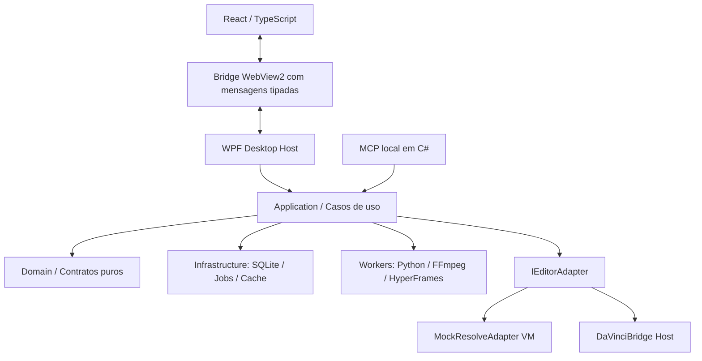

# Arquitetura .NET — núcleo, UI e workers

## Decisão principal

Aplicação Windows **.NET 10**: shell WPF hospeda **WebView2** com uma única SPA React/Vite/TypeScript; núcleo de domínio e casos de uso em C#; persistência EF Core + SQLite; workers subprocessados em Python/FFmpeg/Node; ponte DaVinci isolada e substituível.



## Organização recomendada

```text
TravelCutStudio/
├── src/
│   ├── TravelCut.Desktop/           # WPF/WebView2, boot e ciclo de vida
│   ├── TravelCut.Frontend/          # React/TS/Vite/Tailwind
│   ├── TravelCut.Domain/            # entidades, value objects, invariantes
│   ├── TravelCut.Application/       # casos de uso, portas e orquestração
│   ├── TravelCut.Infrastructure/    # EF Core, cache, jobs, filesystem, processos
│   ├── TravelCut.Contracts/         # DTOs, schemas e versionamento
│   ├── TravelCut.McpServer/         # servidor MCP stdio ou transporte suportado
│   └── TravelCut.ResolveBridge/     # cliente da bridge Python, capabilities
├── workers/
│   ├── python/                      # Whisper, cena, reconhecimento
│   └── hyperframes/                 # render de animação opcional
├── tests/
│   ├── Unit/
│   ├── Contract/
│   ├── Integration/
│   ├── UI/
│   └── Fixtures/                   # mídia sintética pequena
├── docs/ .claude/ prompts/ progresso/ referencias/
└── README.md
```

## Dependências em camadas

- Domain não depende de Application, UI, EF Core, DaVinci, FFmpeg ou MCP.
- Application depende de Domain e de interfaces (portas), nunca do executável concreto de Python/DaVinci.
- Infrastructure resolve interfaces de repositório, execução de jobs, cache, caminhos e processo.
- Desktop/MCP apenas orquestram casos de uso; implementam **o mesmo backend**, evitando lógica duplicada.
- Frontend não acessa arquivos arbitrários nem roda shell. Toda chamada WebView2 é validada e autorizada no host.

## Ponte de mensagens WebView2

Mensagens tipadas `requestId`, `version`, `type`, `payload`; resposta `ok`, `error`, `payload`. Não aceitar arbitrariamente `executeShell`, caminhos fora do projeto ou URLs externos. Validar origem confiável, tamanho de payload, ordem e permissões. Preferir eventos assinados para jobs (progresso, cancelamento, erro) e comandos somente via aplicação C#.

## Jobs persistentes

`JobQueue` com limite de concorrência, `CancellationToken`, retries apenas para operações idempotentes, `ProcessStartInfo.ArgumentList`, stderr capturado, timeout configurável. Estado persisted no SQLite (`queued`, `running`, `done`, `failed`, `cancelled`, `waiting_for_host`); retomada verifica outputs e nunca reexecuta silenciosamente ação externa não idempotente.

## Modo desenvolvimento sem DaVinci

`IEditorAdapter` expõe capacidades; MockResolve gera registros observáveis mas nunca MP4/projeto real; HostResolveBridge conecta apenas quando usuário ativar e validar o ambiente. Interface rotula claramente `Simulado`, `Indisponível`, `Aguardando host`, `Conectado e validado`. Os contratos devem retornar resultados e erros estruturados.

## Observabilidade

Usar `ILogger` com `ActivityId`, `ProjectId`, `MediaId`, `JobId`; não registrar transcrição privada por padrão. Logs de produto separados do diário do **desenvolvimento** em `progresso/`.

## Desempenho

VM 4 vCPU/15 GB: limitar workers, cachês no disco local K se possível; não usar Z (VMware HGFS) como SQLite ativo ou diretório de build sem validar IO. Arquivos grandes e pesos de modelo nunca incluídos no instalador por acidente.
