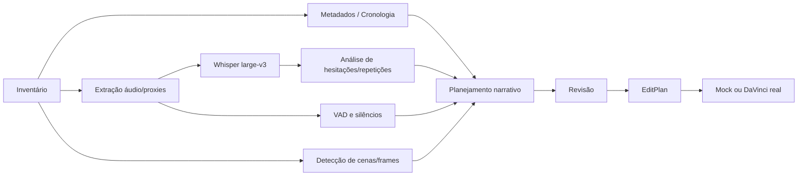

# Pipeline técnico audiovisual

## Fluxo e dependências

## Inventário

Percorrer apenas pastas autorizadas; detectar extensão e `ffprobe` de verdade; codec, áudio, duração real, rotação, perfil de cor, VFR, date tags (QuickTime UTC/local), nome, tamanho, fingerprint. Guardar **origem do timestamp**: GPS/creation_time/container/fs fallback. Não inferir fuso silenciosamente, e não misturar ordem de câmera com ordem de cópia.

## Processamento incremental

Cada etapa cria artefato em `3-Trabalho`; nomes estáveis por IDs, versões e hash. Se mídia/transcrição/profile não mudou, reutilizar cache. Jobs GPU são `host_only` quando necessários; CPU na VM para fixtures pequenos. Gerar miniaturas com amostragem temporal e detecção de mudança, não extrair todos os frames.

## Transcrição

Whisper oficial local com **`large-v3`**; contexto em português, timestamps por palavra quando suportados; JSON normalizado para `text`, `audio_duration_secs`, `words` contendo `text,start,end` em segundos. Validar monotonicidade, overlaps conhecidos, limites e duração. Reconhecer silêncio distinto de falha de reconhecimento; sem supor que todas as palavras foram detectadas.

## Detecção de áudio

- Silêncio: FFmpeg silencedetect/VAD, parametrizável com histerese e ruído ambiente. Uma pausa não é automaticamente corte.
- Hesitação: padrões lexicais com contexto, offsets por palavra e confiança qualitativa; preservar pausa expressiva.
- Regravações: buscar trechos similares semanticamente, marcar versões tentadas, verificar sinais como "não, pera"; nunca remover brincadeira sem revisão quando ambígua.
- Vento/áudio ruim: detectar e **marcar para segunda edição**, processamento agressivo só com pedido.

## Classificação de cenas

Combinar shot boundaries (PySceneDetect/OpenCV), áudio e frames selecionados. Classes: conversa, paisagem, estrada/deslocamento, loja/produto, drone, ambiente, outros. A identificação de drone pode ser inferida de metadados/imagens, registrar hipótese quando não comprovada. Salvar evidências, não pontuação artificial de precisão.

## Ordem cronológica e narrativa

A cronologia é um grafo ordenável com incerteza. Quando câmeras não estão sincronizadas, usar ancoragens visuais/áudio para sugerir reordenação e pendências. A narrativa final pode introduzir gancho fora de ordem com registro claro, sem distorcer fatos.

## Proxies e exportação

Gerar proxies apenas se ajuda desempenho; preservar mapping PTS/timebase e referência ao original. FFmpeg para prévias e comparação leve; encode externo não garante paridade com os filtros do DaVinci. Verificar existência, duração, codecs, sincronia e presença de imagens pretas em testes sintéticos. Evitar reencodar original sem necessidade.

## Infraestrutura de jobs

Estados `queued/running/completed/failed/cancelled/waiting_for_host`; rastrear unidades de trabalho reais. `progress = processed_items / total_items` somente com denominador confiável; caso contrário progresso indeterminado. Retomada após crash via checkpoint e idempotência. Todo subprocesso precisa capturar saída e saída de erro, timeout, cancelamento, logs e código de retorno.
